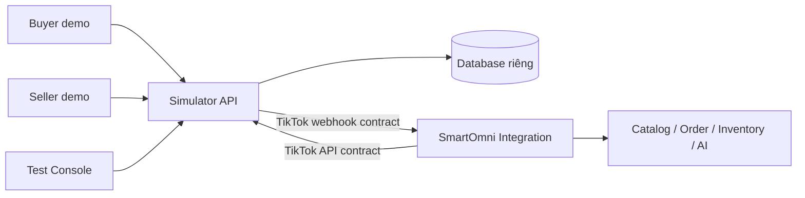

# TikTok Shop Simulator — Overview

> Trạng thái: kế hoạch triển khai, chưa xác nhận đã hoàn thành chức năng.
> Ngày lập: 14/10/2026. Thị trường mục tiêu: shop nội địa Việt Nam, tiền VND.
> Đọc file này trước, sau đó thực hiện các phase theo dependency.

## Mục tiêu

Xây project độc lập `smartomni-tiktok-simulator` để team kiểm thử các chức năng TikTok Shop của SmartOmni trên máy local. Simulator có trạng thái và dữ liệu riêng, dùng API và JSON theo contract TikTok đã xác minh, hỗ trợ Seller demo, Buyer demo và Test Console.

Bản bàn giao gồm simulator và các thay đổi SmartOmni cần thiết để chạy end to end. Chia phase để giao việc và theo dõi tiến độ; nghiệm thu sản phẩm là một bản đủ phạm vi, không coi hoàn thành một phase là hoàn thành toàn bộ hệ thống.

## Checklist tiến độ

Chỉ đổi `[ ]` thành `[x]` sau khi đáp ứng tiêu chí hoàn thành trong file phase, có bằng chứng kiểm thử và review.

- [ ] [Phase 01 — Khóa contract TikTok](01-api-contracts.md)
- [ ] [Phase 02 — Nền tảng, database và giao diện khung](02-foundation.md)
- [ ] [Phase 03 — Cấp quyền và kết nối shop](03-shop-connection.md)
- [ ] [Phase 04 — Catalog, SKU và giá](04-catalog-pricing.md)
- [ ] [Phase 05 — Buyer checkout, đơn hàng, webhook và polling](05-orders-webhooks.md)
- [ ] [Phase 06 — Tồn kho và outbox](06-inventory-outbox.md)
- [ ] [Phase 07 — Vận chuyển, hủy, hoàn và trả hàng](07-fulfillment-returns.md)
- [ ] [Phase 08 — Hội thoại và CSKH](08-conversations.md)
- [ ] [Phase 09 — Coupon và dữ liệu loyalty](09-coupons-loyalty.md)
- [ ] [Phase 10 — Kiểm thử tổng thể và bàn giao](10-testing-handover.md)

Trong mỗi phase, team điền người phụ trách, PR/commit, ngày hoàn thành và đường dẫn báo cáo test. Nếu có blocker, ghi rõ; không tick hoàn thành khi tiêu chí bắt buộc còn thiếu.

## Kiến trúc và tech stack

| Thành phần | Công nghệ / trách nhiệm |
|---|---|
| Simulator API | NestJS + TypeScript, API theo contract TikTok và API demo/test riêng |
| Simulator database | PostgreSQL + Prisma, database độc lập với SmartOmni |
| Webhook worker | Hàng đợi bền vững trong PostgreSQL; retry, lịch sử gửi, replay |
| Frontend | React + TypeScript + Vite; Seller, Buyer, Test Console |
| Media / vận đơn | File local trên Docker volume; PDF giả dùng để test tải/in |
| Triển khai local | Docker Compose; UI 3090, API 8090; database chỉ trong Docker network |
| SmartOmni | Giữ Java 17 / Spring Boot 3, Flyway, PostgreSQL, RabbitMQ và Quartz |
| Kiểm thử | Backend/API tests, contract tests, Playwright, JUnit/Mockito và integration tests với PostgreSQL/RabbitMQ thật |

## Phạm vi giao diện

- **Seller:** cấp quyền app, sản phẩm/SKU, giá/tồn, đơn, vận chuyển, hoàn trả, chat, coupon.
- **Buyer:** danh mục, chi tiết/chọn SKU, giỏ hàng, checkout/thanh toán giả, đơn, yêu cầu hoàn trả, chat.
- **Test Console:** seed/reset, chọn shop, chuyển trạng thái, điều chỉnh thời gian nghiệp vụ, replay webhook, tạo lỗi và xem request/response.

Không có video feed hoặc livestream. Không xử lý tiền thật. Thanh toán SaaS SmartOmni và độ chính xác mô hình AI không thuộc simulator.

## Nguyên tắc API

- Public API mô phỏng giữ method, path, header, kiểu dữ liệu và JSON theo phiên bản TikTok được khóa.
- API nội bộ tạo tình huống dùng `/demo/*`; API điều khiển test dùng `/test-admin/*`.
- Buyer checkout không được quảng bá như TikTok Shop OpenAPI.
- Adapter SmartOmni chuyển JSON sàn sang DTO nội bộ; simulator không trả `WebhookOrderPayload` hoặc `MarketplaceProductDto` thay cho JSON TikTok.
- Phân biệt ký API và ký webhook. Không dùng quy tắc HMAC hiện tại trong repo như bằng chứng đã tương thích TikTok.
- Endpoint chưa xác minh được phải ghi rõ chưa hỗ trợ. Không tự thêm API tạo voucher rồi gọi là API TikTok.
- Tương thích contract local không chứng minh quyền truy cập hoặc mọi hành vi production của TikTok.

## Hiện trạng SmartOmni cần xử lý

Tại thời điểm lập kế hoạch, TikTok client còn stub; kết nối chủ yếu lưu app key/secret; nhập catalog, đồng bộ giá, polling và gọi API từ outbox còn TODO. Webhook chưa ánh xạ đầy đủ payload sàn. Các miền chat, Customer Portal và voucher chưa có API hoàn chỉnh.

Các phase dưới đây bao gồm phần sửa/bổ sung tương ứng trong SmartOmni. Team phải kiểm tra lại code khi bắt đầu để tránh ghi đè công việc mới của người khác.

## Ràng buộc dữ liệu và tenant

- Mỗi tenant có tối đa một shop TikTok; simulator seed hai shop cho hai tenant.
- Simulator giữ shop/seller/buyer ID độc lập; tenant ID của SmartOmni thuộc cấu hình liên kết, không được giả làm field API TikTok.
- SmartOmni dùng TenantContext, RLS và truy vấn theo tenant/connection; không hardcode tenant ID.
- Schema SmartOmni chỉ thêm migration mới; không sửa migration đã áp dụng, giữ Hibernate `validate`.
- Dữ liệu giả có thể seed lại; dữ liệu nghiệp vụ/log phải còn sau restart.
- Clock nghiệp vụ phục vụ test tách khỏi thời gian xác thực request; không thay clock hệ điều hành.

## Cách dùng tài liệu

1. Đọc overview và [bối cảnh nghiệp vụ](../../docs/project-context.md).
2. Khóa contract ở Phase 01, ghi khả năng được hỗ trợ và các điểm chưa xác minh.
3. Làm nền tảng, sau đó các nhóm nghiệp vụ theo dependency ghi trong mỗi phase.
4. Cập nhật checklist từng phase cùng bằng chứng; nghiệm thu toàn bộ ở Phase 10.
5. Khi quyết định thay đổi, sửa cả overview lẫn phase liên quan và ghi lý do trong PR.

## Tài liệu tham chiếu

- [README SmartOmni](../../README.md)
- [Quản lý database migration](../../docs/database-migrations.md)
- [Bối cảnh và quyết định sản phẩm](../../docs/project-context.md)
- [TikTok Shop Partner Center](https://partner.tiktokshop.com/docv2)
- [Common parameters](https://partner.tiktokshop.com/docv2/page/common-parameters)

Các liên kết API trong bộ spec là nguồn đối chiếu từ giai đoạn planning; Phase 01 phải kiểm tra lại schema, phiên bản và phạm vi áp dụng trước triển khai.

